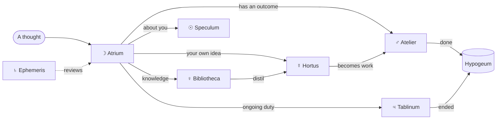

Mnemosyne is built on the *ars memoriae*, the classical art of memory. Simonides, Cicero, and Quintilian taught orators to place what they had to remember in the rooms of an imagined building: each memory in a *locus* (a place), marked by an *imago* (a vivid image). Giulio Camillo turned the method into a Theatre of Memory ordered by the seven planets. Giordano Bruno made it a Hermetic art.

Here the building is real. Each room is a folder, and each room's image is its planetary sign.

## Floor plan

| Room | Function | Sign | Holds | Leaves when |
| --- | --- | --- | --- | --- |
| [Atrium](/atrium) | Capture | ☽ Moon: receptive, ever-changing | Everything new and unsorted | Sorted at the weekly review |
| [Atelier](/atelier) | Projects | ♂︎ Mars: action | Efforts with an outcome and a horizon date | Done or abandoned, then archived |
| [Tablinum](/tablinum) | Areas | ♃ Jupiter: stewardship and order | Responsibilities kept to a standard | The responsibility ends |
| [Bibliotheca](/bibliotheca) | Resources | ♀︎ Venus: beauty and the arts | Knowledge, sources, and collected beauty, by shelf | No longer relevant |
| [Hortus](/hortus) | Ideas | ☿ Mercury: thought and connection | Your own ideas, one per note, linked | Never; it matures instead |
| [Ephemeris](/ephemeris) | Time | ♄ Saturn: time and discipline | Daily notes and reviews | Never; it is the chronicle |
| [Speculum](/speculum) | Self | ☉ Sun: the self at the centre | Profile, polarity map, decisions | Never; revised each season |
| [Hypogeum](/hypogeum) | Archive | Below the seven | Everything inactive | Retrieved on demand |

Read the seven in the Chaldean order, Saturn to Moon, and the Sun stands fourth: at the centre. So does the Speculum. The palace is organised around a mirror.

The structure follows proven practice beneath the symbolism. The Atelier, Tablinum, Bibliotheca, and Hypogeum are Tiago Forte's PARA method: projects, areas, resources, archive. The Hortus is a *Zettelkasten*, Niklas Luhmann's slip-box of atomic, linked ideas. The Speculum is the part no method provides: a model of you, so the palace can reason as your counterpart.

## How a thought travels

Two currents matter most. Reading flows from the Bibliotheca into the Hortus: what you collect becomes what you think. Ideas flow from the Hortus into the Atelier: what you think becomes what you make.

## Where does it go?

Ask these questions in order. The first yes decides.

1. Can it be acted on, and does it end? **Atelier.**
2. Is it a responsibility that never ends? **Tablinum.**
3. Is it your own idea, insight, or argument? **Hortus.**
4. Is it about your mind, your values, or a decision? **Speculum.**
5. Is it knowledge, a source, or something beautiful you collected? **Bibliotheca.**
6. Is it a dated reflection or log? **Ephemeris.**
7. Is it finished or inactive? **Hypogeum.**
8. Unsure? It waits in the **Atrium** until the weekly review.

One capture can split. A quotation from Palladio goes to the architecture shelf; your reaction to it becomes a seed in the Hortus.

## Conventions

- **File names** are lowercase Latin letters with hyphens. Bulgarian titles are transliterated: `Златно сечение` becomes `zlatno-sechenie.md`. Dated notes begin with the ISO date.
- **Every note** carries frontmatter: `title`, `description`, `room`, `type`, `status`, `tags`, `created`, `updated`, and `lang`.
- **Languages** are free. Write in Bulgarian, English, or French; the note keeps the language you chose.
- **Ideas are titled as claims.** "Proportion is a form of memory", not "Proportion".
- **Nothing is deleted.** Inactive notes descend to the Hypogeum with a date and a reason.

Templates for every note type live in the `_templates/` folder of the repository.
